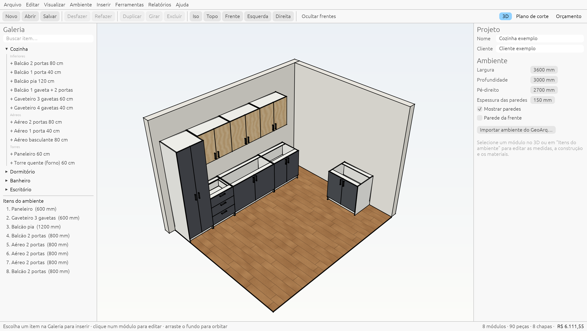

# Planejei

**English** · [Português (Brasil)](README-pt-br.md)



Planejei is a desktop app for designing built-in furniture and custom cabinetry. Its workflow is
inspired by commercial cabinet-design software such as Promob. It is a sibling of GeoArq and
shares the same 3D engine (Rust + wgpu + egui) and the same navigation.

You lay out a room with parametric modules, and Planejei gives you a **parts list, a cutting
plan and a quote**.

The interface is in Brazilian Portuguese. This README gives English translations of the menu
and button names in parentheses.

Scope and roadmap: [docs/SCOPE.md](docs/SCOPE.md). Presentation video: [docs/video](docs/video/SCRIPT.md).

## Run

```bash
cargo run --release                          # empty project
PLANEJEI_DEMO=kitchen cargo run --release    # sample kitchen
cargo run --release -- project.planejei      # open a project
cargo test                                   # modules, cutting plan, quote, snapping
```

## Build the installers

```bash
./scripts/build.sh            # macOS + Windows
./scripts/build.sh mac        # macOS only (universal: Apple Silicon + Intel)
./scripts/build.sh windows    # Windows only (64-bit)
```

The script updates the third-party license list and runs the tests. It writes these files to
`dist/`:

- `Planejei-<version>-mac.zip` and `.dmg`: the app, with a local ad-hoc signature.
- `Planejei-<version>-windows.zip`: a portable build.
- `Planejei-<version>-setup.exe`: an installer that associates `.planejei` files with the app.

To build for Windows from a Mac, install the toolchain once with `brew install mingw-w64 makensis`.
The version number comes from `Cargo.toml`.

## Interface

- **Gallery** (*Galeria*, left): Kitchen, Bedroom, Bathroom and Office.
  - Clicking an item inserts the module against the back wall.
  - It goes next to the last module in the same row, either base or wall cabinets.
- **Properties** (*Propriedades*, right):
  - Width × height × depth, position and rotation.
  - Doors, drawers, shelves, dividers, toe kick and hanging rail.
  - Materials for the carcass, fronts and back.
  - Everything recalculates instantly. With nothing selected, the panel edits the project and
    the room.
- **Tabs**:
  - *3D*.
  - *Plano de corte* (cutting plan): every sheet drawn, with its yield.
  - *Orçamento* (quote).
- **Menus**:
  - *Arquivo* (File), *Editar* (Edit), *Visualizar* (View), *Ambiente* (Room), *Inserir* (Insert).
  - *Ferramentas* (Tools): materials, hardware, prices, saw kerf and trim.
  - *Relatórios* (Reports) and *Ajuda* (Help).

| Action | How |
|---|---|
| Move a module | drag it (it snaps and turns to the nearest wall and lines up with its neighbours) |
| Orbit / pan / zoom | drag the background or middle button / Shift + drag / wheel or pinch |
| Rotate · Duplicate · Delete | R · Cmd/Ctrl+D · Delete |
| Nudge | arrow keys (10 mm), Shift + arrows (100 mm) |
| Views | 0 Iso · 1 Top · 2 Front · 3 Back · 4 Left · 5 Right · Shift+Z zoom to fit |
| Hide doors and fronts | F |

Walls between the camera and the room hide automatically.

## Exports

- **Parts list (CSV)**: `;`-separated, ready for cutting optimizers and panel saws.
- **Cutting plan (SVG)**.
- **Proposal (HTML)**: modules, quote, parts list and cutting plan. It opens in the browser; use
  Print › Save as PDF to get a PDF.

## GeoArq rooms

**Arquivo › Importar ambiente do GeoArq…** (File › Import GeoArq room) loads the geometry of a
`.geoarq` file as a visual reference. The path is saved in the project, and the room reloads when
you open it.

## Code

| File | What it does |
|---|---|
| `module.rs` | parametric modules → boards (cut size, edge banding) and hardware; the gallery |
| `cutting.rs` | guillotine cutting plan (saw kerf, trim, wood grain) |
| `budget.rs` | quote (sheets, edge banding, hardware, labour, margin) |
| `project.rs` | project, room, snapping, `.planejei` files and `.geoarq` import |
| `reports.rs` | CSV, SVG and HTML exports |
| `app.rs` | user interface |
| `renderer.rs`, `camera.rs`, `geom/`, `textures.rs`, `shader.wgsl` | engine shared with GeoArq |

### Development variables

To check the UI visually, run `PLANEJEI_SCREENSHOT=out.png cargo run`. It saves a screenshot and
exits. Combine it with:

| Variable | Effect |
|---|---|
| `PLANEJEI_DEMO=kitchen` | opens the sample kitchen |
| `PLANEJEI_TAB=cut` or `budget` | starts on the cutting plan or quote tab |
| `PLANEJEI_SELECT=2` | selects the module at index 2 |
| `PLANEJEI_VIEW=top`, `front`… | initial camera view |
| `PLANEJEI_HIDE_FRONTS=1` | hides doors and fronts |
| `PLANEJEI_CATALOG=1`, `PLANEJEI_PARTS=1`, `PLANEJEI_ABOUT=1` | opens the materials, parts list or About window |
| `PLANEJEI_SIZE=1600x900` | window size |
| `PLANEJEI_DUMP=folder` | writes the project and its exports (CSV, SVG, HTML) to that folder |

The icon is drawn in `assets/icon.svg`. The files `icon.png`, `icon.icns` and `icon.ico` are
generated from it.

## License

Copyright (C) 2026 Lucas Bernardo.

Planejei is free software. You can redistribute it and modify it under the terms of the
[GNU General Public License](LICENSE), version 3 or (at your option) any later version
(`GPL-3.0-or-later`). It comes with no warranty.

Third-party libraries and fonts are listed in [THIRD_PARTY.md](THIRD_PARTY.md). The script
`./scripts/third_party.sh` generates that file, and `build.sh` runs it automatically. Anyone who
distributes the installers must also offer the corresponding source code, as the GPL requires.
